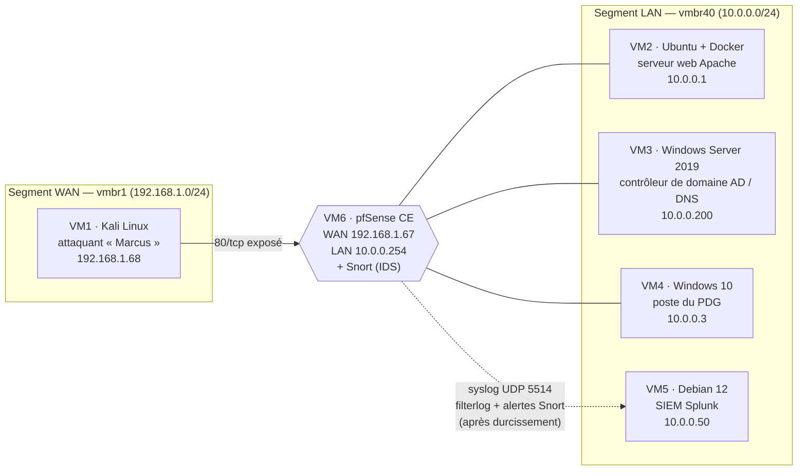
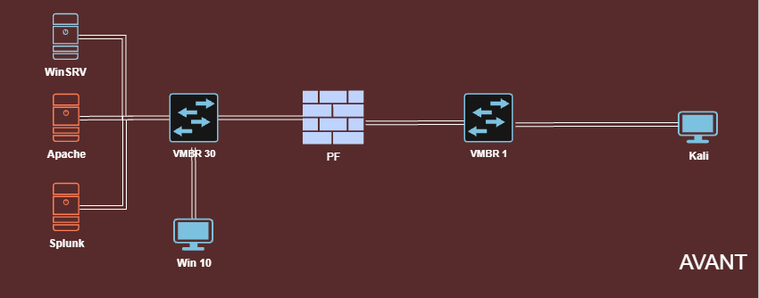
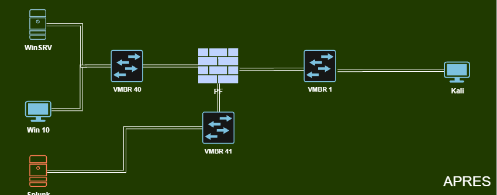
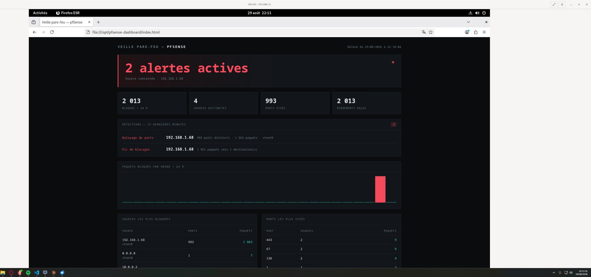

# Iron4Software — Audit, sécurisation et supervision d'une infrastructure vulnérable

> **Mémoire de projet ingénieur en cybersécurité** · DataScientest × CyberUniversity · 2024–2026
>
> Une TPE fictive de 8 salariés, un laboratoire isolé sous Proxmox VE, une attaque par ransomware rejouée de bout en bout — puis la détection, le durcissement, la gouvernance et la réponse à incident. Avec une règle tenue du début à la fin : **ne présenter comme réalisé que ce qu'une trace démontre**.

**Mémoire complet (PDF, 63 p.) : [`memoire/Memoire-Iron4Software.pdf`](memoire/Memoire-Iron4Software.pdf)**

---

## En bref

| | |
|---|---|
| **Contexte** | TPE éditrice de logiciels RH, sans PSSI, sans DSI, sans EDR, sans sauvegarde définie |
| **Laboratoire** | Proxmox VE · 6 VM (Kali attaquant, serveur web, contrôleur de domaine, poste du PDG, SIEM, pare-feu pfSense) |
| **Démarche** | 7 phases : mise en place → intrusion → forensique → durcissement → ré-attaque → risques ISO 27005/27001 → réponse ISO 27035 |
| **Constat clé** | Au moment de l'attaque, le SIEM était installé mais **aveugle : 0 événement** dans les index métier |
| **Résultat clé** | Après durcissement : chaîne pfSense → Splunk opérationnelle (**2 034 événements / 24 h**) et **détection automatique** d'un balayage de 993 ports, sans licence commerciale |

---

## Auteurs et rôles

Travail réalisé à trois ; les trois auteurs ont accepté sa publication.

| Auteur | Périmètre principal |
|---|---|
| **Hugo Loureiro** — [hloureiro.fr](https://hloureiro.fr) · [GitHub](https://github.com/Lightshadow02) · [LinkedIn](https://www.linkedin.com/in/h-loureiro/) | Infrastructure Proxmox, segmentation réseau, chaîne de collecte pfSense → Splunk, IDS Snort, dispositif d'alerting et tableau de bord maison, VPN WireGuard (cible), politique de sauvegarde 3-2-1 |
| **Clément Bastien** | Tests d'intrusion, forensique mémoire, durcissement Windows |
| **Maxime Corazzi** | Ré-attaque après durcissement, gestion des risques et conformité ISO 27005/27001, plan de réponse aux incidents ISO 27035 |

---

## Problématique

> Comment une TPE dépourvue de politique de sécurité et de moyens dédiés peut-elle **détecter, analyser et contenir** une attaque par ransomware, et quelles mesures — techniques comme organisationnelles, et réalistes à son échelle — permettent d'en **réduire durablement l'exposition** ?

Trois sous-questions :

1. Jusqu'où un attaquant opportuniste peut-il progresser dans une infrastructure de TPE laissée en l'état, et quelle trace laisse-t-il ?
2. Quelles capacités de détection une petite structure peut-elle réellement mettre en œuvre **sans licence coûteuse ni équipe dédiée** ?
3. Quelles mesures de durcissement offrent le meilleur rapport **effort / risque évité** pour une entreprise de cette taille ?

L'adversaire du scénario, « Marcus », est un attaquant opportuniste de niveau intermédiaire, motivé par l'argent et limité à des outils publics. Chaque faiblesse introduite dans le laboratoire reste à sa portée.

---

## Architecture du laboratoire



État initial : un seul segment LAN « à plat » derrière pfSense. Après les phases offensives, VM2 est déconnectée et une **architecture cible** sépare un segment *Interne* (DC, postes) d'un segment *Management* (SIEM, administration) — voir [Phase 4](docs/04-durcissement.md).

| Avant | Après (schéma de l'architecture cible) |
|---|---|
|  |  |

---

## Les 7 phases

| # | Phase | Ce qu'elle montre |
|---|---|---|
| 1 | [**Mise en place et exposition contrôlée**](docs/01-mise-en-place.md) | Déploiement du laboratoire, configuration volontairement vulnérable calibrée sur le profil de l'attaquant. Premier enseignement : un SIEM « démarré » n'est pas un SIEM qui collecte. |
| 2 | [**Tests d'intrusion**](docs/02-tests-intrusion.md) | Depuis le seul service web exposé, un attaquant opportuniste atteint le réseau interne, cartographie l'Active Directory et chiffre les fichiers du poste du PDG. Synthèse volontairement haut niveau. |
| 3 | [**Analyse forensique et réponse à incident**](docs/03-forensique.md) | Le SIEM n'avait rien vu. L'analyse mémoire du poste devient la seule source capable de prouver le canal de commande actif et de reconstruire la chronologie. |
| 4 | [**Durcissement de l'infrastructure**](docs/04-durcissement.md) | Retrait du serveur exposé, durcissement Windows et Linux, collecte pfSense → Splunk, IDS Snort, alerting maison sans licence, cibles WireGuard et 3-2-1. Cœur défensif du projet. |
| 5 | [**Ré-attaque après durcissement**](docs/05-re-attaque.md) | Les trois vecteurs démontrés sont rejoués : pivot indisponible, charge malveillante mise en quarantaine, SMBv1 en cours de suppression. Aucun « 100 % → 0 % » artificiel. |
| 6 | [**Gestion des risques et conformité ISO 27001**](docs/06-risques-conformite.md) | Matrice de risques ISO 27005 (deux risques critiques à 20/25), checklist ISO 27001, PSSI adaptée à une TPE et plan d'actions priorisé. |
| 7 | [**Réponse aux incidents (ISO 27035)**](docs/07-reponse-incidents.md) | Plan de réponse formalisé à partir de l'incident : niveaux de gravité, confinement sans perte de preuves, éradication proportionnée, reprise par priorités RTO et retour d'expérience. |

---

## Résultats clés

**Avant durcissement — au moment de l'incident**

- Chaîne d'attaque complète démontrée par les traces : service web → pivot vers le LAN → poste du PDG → **29 fichiers chiffrés** annoncés par le script (30 artefacts recensés à l'investigation).
- SIEM Splunk installé mais **aveugle** : index `main` et `iron4software` à **0 événement**, **0 forwarder sur 4 machines**, 0 entrée réseau. Seul l'index interne de Splunk était alimenté (1,27 M événements).
- Le canal de commande de l'attaquant était **encore actif ~16 h après le chiffrement**, prouvé uniquement par l'analyse mémoire.

**Après durcissement**

| Indicateur | Avant | Après |
|---|---|---|
| Index `pfsense` | inexistant | **2 034 événements / 24 h**, ingestion continue |
| Extraction de champs `filterlog` | aucune | **plus de 20 champs typés** |
| IDS | absent | **Snort** sur l'interface WAN (règles Community + Emerging Threats) |
| Alerting | absent | **analyse automatique toutes les 5 min**, coût de licence nul |
| Détection d'un balayage de ports | impossible | **2 alertes automatiques** : 993 ports distincts, 1 963 paquets depuis 192.168.1.68 |
| Charge malveillante rejouée sur VM4 | exécutée | **détectée et mise en quarantaine**, non exécutée |
| Point de pivot VM2 | disponible | **retiré** du laboratoire |



*Tableau de bord maison alimenté par Splunk : 2 alertes actives, 2 013 paquets bloqués sur 24 h, 4 sources, 993 ports visés, pic unique sur l'histogramme horaire.*

---

## Démontré / non démontré

Le mémoire distingue systématiquement ce que les preuves établissent de ce qui relève de la mise en situation ou de la cible. Ce dépôt reprend la même ligne.

| Démontré par les traces | Non démontré (scénarisé, cible ou non concluant) |
|---|---|
| Accès initial au serveur web et pivot vers le LAN | Exploitation de la CVE Apache prévue (la version déployée n'y est pas vulnérable) |
| Identification du domaine AD et du contrôleur de domaine | Exploitation EternalBlue / MS17-010 (contrôle non concluant) |
| Session interactive sur VM4 sous un compte de domaine standard | Livraison réelle d'un e-mail de phishing (dépôt manuel du fichier piégé) |
| Chiffrement de fichiers, note et fond d'écran de rançon | Élévation au niveau SYSTEM, extraction des secrets du domaine |
| Canal de commande actif dans le dump mémoire | Déploiement des forwarders Splunk et centralisation des journaux Windows |
| SIEM aveugle au moment de l'incident (0 événement) | Segmentation Interne / Management déployée (script non exécuté : architecture cible) |
| Durcissement VM3, VM4, VM5 (avec réserves documentées) | VPN WireGuard en exploitation |
| Chaîne pfSense → Splunk, Snort et alerting automatique | Sauvegarde 3-2-1 opérationnelle, temps de restauration mesurés |
| Détection automatique du balayage de ports | Externalisation du site vitrine |
| Quarantaine Defender lors de la ré-attaque | Campagne de sensibilisation et taux de clic mesurés |

---

## Compétences mobilisées

- **Architecture et virtualisation** : conception d'un laboratoire représentatif sous Proxmox VE, ponts virtuels, adressage, pare-feu pfSense.
- **Segmentation et filtrage** : séparation Interne / Management, matrice de flux, politique de blocage WAN, accès distants par VPN.
- **Supervision et détection** : collecte syslog pfSense vers Splunk, parsing `filterlog`, IDS Snort, développement d'un dispositif d'alerting et d'un tableau de bord pour contourner une contrainte de licence.
- **Durcissement** : Windows Server / Active Directory, Windows 10, Debian (SSH, UFW, Fail2Ban, auditd).
- **Forensique et réponse à incident** : acquisition et analyse mémoire, chronologie, IOC, confinement préservant les preuves.
- **Tests d'intrusion** : reconnaissance, pivot, énumération Active Directory, compromission de poste (en laboratoire isolé).
- **Gouvernance, risques, conformité** : ISO/IEC 27005, 27001, 27035, PSSI, plan d'actions, MITRE ATT&CK.
- **Rigueur de preuve** : distinguer le démontré du scénarisé, documenter les écarts et les erreurs plutôt que les masquer.
- **Travail en équipe** sur un projet couvrant à la fois l'offensif et le défensif.

## Stack technique

| Domaine | Outils |
|---|---|
| Virtualisation | Proxmox VE |
| Réseau / pare-feu | pfSense CE, WireGuard (cible) |
| Détection | Splunk Enterprise 9.2.1 (édition gratuite), Snort (Community + Emerging Threats), Sysmon 15.21 |
| Systèmes | Windows Server 2019 (AD, DNS), Windows 10 22H2, Debian 12, Ubuntu 16.04 + Docker |
| Durcissement Linux | OpenSSH, UFW, Fail2Ban, auditd |
| Forensique | Volatility 3 |
| Offensif (laboratoire) | Kali Linux et outillage public de test d'intrusion |
| Continuité (cible) | Stratégie 3-2-1, stockage distant chiffré (Infomaniak), Veeam |
| Référentiels | ISO/IEC 27001:2022, 27005:2022, 27035-1:2023, MITRE ATT&CK |

---

## Limites et perspectives

- **Détection** : déployer et valider les forwarders sur toutes les machines, centraliser les journaux Windows et Sysmon, puis passer Snort en mode prévention après une période d'observation.
- **Résilience** : mettre réellement en œuvre la sauvegarde 3-2-1 et la valider par des restaurations chronométrées (RTO/RPO).
- **Architecture** : déployer la segmentation cible, le VPN WireGuard et l'externalisation du site vitrine, puis les documenter.
- **Gouvernance** : faire valider la PSSI par la direction et éprouver le plan de réponse par un exercice sur table.
- **Facteur humain** : mener une campagne de sensibilisation mesurée (taux de clic, taux de signalement), seul maillon que le laboratoire ne pouvait pas reproduire fidèlement.

> *Une part importante du risque d'une TPE se réduit avec des moyens modestes, à condition d'accepter une exigence simple : vérifier que chaque mesure fait réellement ce qu'on attend d'elle.*

---

## Structure du dépôt

```
Iron4Software/
├── README.md                      ← cette page
├── memoire/
│   └── Memoire-Iron4Software.pdf  ← mémoire complet (détail technique, annexes)
├── docs/
│   ├── 01-mise-en-place.md
│   ├── 02-tests-intrusion.md
│   ├── 03-forensique.md
│   ├── 04-durcissement.md
│   ├── 05-re-attaque.md
│   ├── 06-risques-conformite.md
│   └── 07-reponse-incidents.md
└── assets/                        ← captures et schémas extraits du mémoire
```

---

Toutes les manipulations offensives ont été réalisées dans un laboratoire isolé, sur des machines appartenant aux auteurs ; l'entreprise et ses salariés sont fictifs.

**Travail académique — tous droits réservés aux auteurs.**
