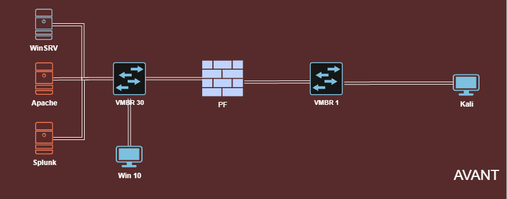

# Phase 1 — Mise en place et exposition contrôlée

[← README](../README.md) · [Phase 2 →](02-tests-intrusion.md)

> **Objectif.** Déployer le laboratoire représentant Iron4Software, vérifier l'adressage et la séparation WAN / LAN, et configurer des services volontairement vulnérables, calibrés sur le profil de l'attaquant « Marcus ».
>
> Référence : mémoire, Introduction (p. 9-11), Phase 1 (p. 12-14) et Annexe A (p. 49-50).

---

## Pourquoi cette phase compte

Tout le reste du projet dépend de la représentativité du laboratoire. L'enjeu n'était pas de construire une infrastructure « piégée » au maximum, mais une infrastructure **crédible pour une TPE** : un serveur web exposé, un Active Directory, un poste de direction, un serveur de supervision et un pare-feu — avec les fragilités qu'on rencontre réellement dans ce type de structure.

## L'entreprise simulée

**Iron4Software** est une TPE fictive de huit salariés, basée en région parisienne, qui édite des logiciels métier pour les services RH. Son profil :

- serveurs Linux et Windows, un serveur web exposé à Internet pour la clientèle ;
- direction consciente du risque cyber, mais **aucune PSSI, aucun PCA/PRA** formalisé ;
- **aucun EDR**, **aucune stratégie de sauvegarde** réellement définie ;
- informatique gérée par un salarié généraliste à mi-temps, sans mandat ni budget sécurité.

**Surface d'exposition humaine.** Le site vitrine publie une page « Équipe » présentant cinq des huit collaborateurs (nom, fonction, adresse professionnelle) : PDG, directeur technique, développeuse senior, responsable RH, support IT. Ces informations publiques constituent une surface de reconnaissance (OSINT) exploitable pour un hameçonnage ciblé. Les trois autres salariés, non exposés, ne sont pas intégrés au scénario.

**L'adversaire.** « Marcus » est un attaquant opportuniste, de niveau intermédiaire, à motivation financière, qui n'utilise que des outils publics et documentés. Chaque faiblesse introduite dans l'infrastructure — CVE Apache datée, SMBv1, absence de MFA, macro Office — doit rester à sa portée.

---

## 1.1 Architecture de l'infrastructure

Le laboratoire tourne sous **Proxmox VE** et compte six machines virtuelles :

- **actifs d'Iron4Software** : VM2, VM3, VM4 ;
- **composants hors périmètre entreprise** : VM1 (attaquant), VM5 (supervision), VM6 (pare-feu).

Le cahier des charges impose trois à cinq VM pour les services de l'entreprise : la contrainte est respectée. La machine Kali n'est pas un actif audité, mais un composant de scénario utilisé uniquement pour les phases offensives.

| VM | Système | Rôle |
|---|---|---|
| VM1 | Kali Linux 2026.x (noyau 6.12) | Poste attaquant « Marcus » |
| VM2 | Ubuntu 16.04.7 (noyau 4.4.0-186) | Hôte du service web ; le service tourne dans un conteneur Docker basé sur `php:7.4-apache` et s'annonce comme Apache/2.4.54 (Debian), PHP/7.4.33 |
| VM3 | Windows Server 2019 (build 17763) | Contrôleur de domaine Active Directory `Iron4Software.lan`, DNS, partage SMB |
| VM4 | Windows 10 22H2 (build 19045.6456) | Poste client représentant le PDG, joint au domaine |
| VM5 | Debian 12 | Hôte du SIEM Splunk Enterprise 9.2.1 (édition gratuite), interface web sur 8000/tcp |
| VM6 | pfSense CE | Pare-feu séparant le segment WAN (attaquant) du segment LAN (actifs) |

### Topologie réseau

L'adressage a été vérifié machine par machine (`ip a` sous Linux, `ipconfig` sous Windows, `ifconfig` sur pfSense).

| VM | Adresse | Segment |
|---|---|---|
| VM1 — Kali | 192.168.1.68/24 | `vmbr1` (WAN), passerelle 192.168.1.254 |
| VM2 — Ubuntu | 10.0.0.1/24 | `vmbr40` (LAN) |
| VM3 — Windows Server | 10.0.0.200/24 | `vmbr40` (LAN), serveur DNS du domaine |
| VM4 — Windows 10 | 10.0.0.3/24 | `vmbr40` (LAN) |
| VM5 — Debian / Splunk | 10.0.0.50/24 | `vmbr40` (LAN) |
| VM6 — pfSense | WAN 192.168.1.67 (`vtnet0`) · LAN 10.0.0.254 (`vtnet1`) | passerelle du LAN |

- Passerelle LAN : `10.0.0.254` · DNS interne : `10.0.0.200` (VM3) · Domaine : `Iron4Software.lan`
- Les segments reposent sur des **ponts virtuels Proxmox** (`vmbr`), et non sur des VLAN 802.1Q : cela permet de réorganiser le réseau librement, ce qui sera exploité en [Phase 4](04-durcissement.md).

Vérification des interfaces pfSense (Annexe A.6) :

```text
$ ifconfig vtnet0
vtnet0: flags=8843<UP,BROADCAST,RUNNING> mtu 1500
        inet 192.168.1.67 netmask 0xffffff00      (WAN)

$ ifconfig vtnet1
vtnet1: flags=8843<UP,BROADCAST,RUNNING> mtu 1500
        inet 10.0.0.254 netmask 0xffffff00        (LAN)
```



*Schéma « avant » (Annexe I.4) : un LAN unique derrière pfSense, toutes les machines internes au même niveau.*

> **Écart constaté et conservé.** La conception prévoyait qu'aucune VM du LAN n'ait d'accès direct à Internet, tout trafic passant par pfSense. Le contrôle terrain montre que **VM2 et VM5 disposent en réalité d'un accès Internet direct** (ping vers un résolveur public réussi). L'écart a été documenté et laissé en l'état : le relever fait partie de l'audit.

---

## 1.2 Services et configurations volontairement vulnérables

Chaque service a été vérifié, puis ajusté pour correspondre au niveau de Marcus. Point méthodologique important : **l'état mesuré n'est pas toujours l'état prévu**, et le mémoire retient systématiquement l'état mesuré.

### VM2 — Ubuntu / Docker / Apache

- Hôte Ubuntu 16.04.7 ; service exposé depuis un conteneur Docker répondant comme Apache/2.4.54 et PHP 7.4.33.
- Le scénario prévoyait l'étude de **CVE-2021-41773** (path traversal Apache). Les essais conservés **ne démontrent pas** d'exploitation : la version 2.4.54 n'est pas vulnérable à cette CVE.
- Un webshell PHP volontairement présent constitue le point d'entrée réel de la Phase 2.

### VM3 — Windows Server 2019 (contrôleur de domaine)

État initial confirmé :

| Contrôle | État constaté |
|---|---|
| SMBv1 | **Activé** |
| Windows Update | **Arrêté** |
| Pare-feu Windows | **Trois profils désactivés** |
| Defender — protection temps réel | **Désactivée** |
| Politique de mot de passe | **Faible** |
| Transfert de zone DNS (AXFR) | **Ouvert** |
| RDP — NLA | Active (`1`) : le « RDP sans NLA » visé par le scénario n'est **pas** retenu comme état constaté |

Contrôles de l'état initial (Annexe A.3) :

```powershell
PS> Get-WindowsFeature FS-SMB1
Display Name              Name                Install State
------------              ----                -------------
SMB 1.0/CIFS File Sharing FS-SMB1             Installed

PS> Get-ADUser test | Select Name, Enabled, PasswordLastSet
Name Enabled PasswordLastSet
---- ------- ---------------
test True      8/20/2024 10:00:00 AM
```

### VM4 — Windows 10 (poste du PDG)

L'état constaté **diffère de la baseline vulnérable prévue** :

| Contrôle | Baseline visée | État mesuré |
|---|---|---|
| Defender temps réel | désactivé | **déjà actif** |
| NLA (RDP) | désactivée | **déjà active** |
| Compte local `user` | présent | absent |
| Compte Invité | actif | désactivé |
| Signature SMB | — | **désactivée** (`RequireSecuritySignature=False`) |

La baseline visée (Annexe A.4) documente l'intention, pas l'état réel :

```powershell
PS> Get-MpPreference | Select DisableRealtimeMonitoring, DisableBehaviorMonitoring
DisableRealtimeMonitoring : True
DisableBehaviorMonitoring : True
```

Conséquence : la [Phase 4](04-durcissement.md) est présentée comme un **renforcement de posture** sur VM4, et non comme la correction d'un état identique en tous points au scénario théorique.

---

## 1.3 Installation du SIEM et collecte initiale — un faux positif

L'installation de Splunk sur VM5 a d'abord laissé croire à un SIEM opérationnel :

```text
$ /opt/splunk/bin/splunk --version
Splunk 9.2.1 (build 78803f08aabb)
```

Le service `splunkd` était actif et les ports attendus semblaient en écoute. **C'était un faux positif** : ces contrôles prouvaient que le service était démarré, pas que les journaux des machines étaient collectés. En réalité, **aucune entrée de données ni aucun forwarder n'avait été configuré**.

> **Enseignement.** Un service actif et des ports ouverts ne suffisent pas à établir qu'un SIEM fait son travail. Seule la vérification de la **réception effective des journaux** (nombre d'événements par index, par source, horodatage récent) le démontre. Ce point, anodin en apparence, pèsera lourd au moment de l'investigation ([Phase 3](03-forensique.md)) et structure toute la refonte de la supervision ([Phase 4](04-durcissement.md)).

---

## Ce que la phase a appris

- **Mesurer plutôt que supposer** : trois écarts entre conception et réalité (accès Internet direct de VM2/VM5, Defender et NLA déjà actifs sur VM4, NLA active sur VM3) ont été documentés au lieu d'être masqués.
- **Un réseau à plat** derrière un pare-feu périmétrique ne protège que le périmètre : une fois un hôte interne atteint, tout le LAN est au même niveau.
- **« Installé » n'est pas « opérationnel »** — leçon fondatrice pour le volet supervision.

[← README](../README.md) · [Phase 2 →](02-tests-intrusion.md)
