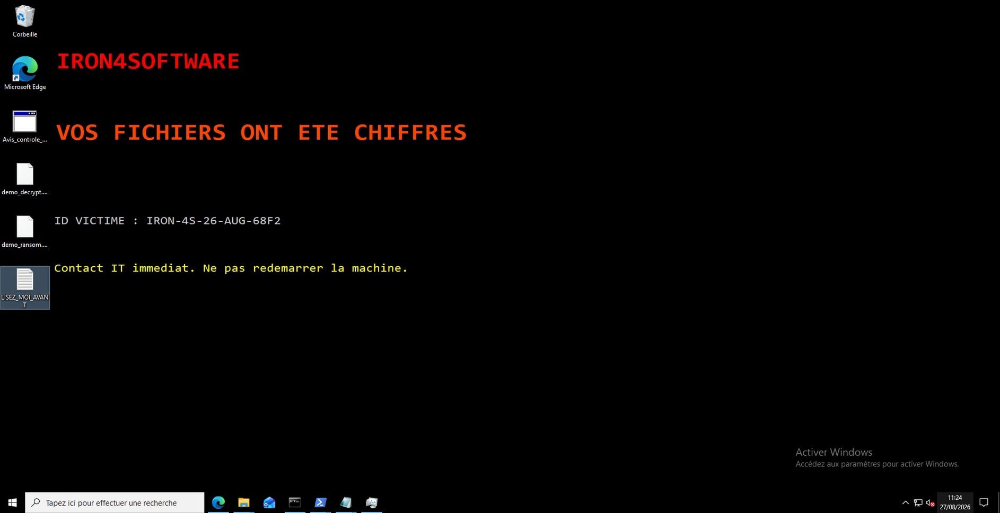

# Phase 2 — Tests d'intrusion (synthèse)

[← Phase 1](01-mise-en-place.md) · [README](../README.md) · [Phase 3 →](03-forensique.md)

> **Objectif.** Évaluer jusqu'où un attaquant opportuniste peut progresser depuis le périmètre exposé, et mesurer l'impact d'une compromission du poste du dirigeant.
>
> Cette page est volontairement une **synthèse haut niveau** : elle décrit les étapes et ce que chacune a révélé, sans commande ni mode opératoire. Le détail technique figure dans le [mémoire](../memoire/Memoire-Iron4Software.pdf) (Phase 2, p. 15-19, et Annexe B). Toutes les manipulations ont eu lieu dans le laboratoire isolé.

---

## La chaîne d'attaque en six étapes

| # | Étape | Ce qu'elle a montré |
|---|---|---|
| 1 | **Reconnaissance du périmètre** | Un seul service web exposé, dans une version datée, **sans en-têtes de sécurité HTTP**. La page « Équipe » du site fournit les cibles d'un hameçonnage. La CVE Apache prévue n'est **pas exploitable** sur la version déployée. |
| 2 | **Accès initial au serveur web** | Un webshell présent sur le serveur donne l'exécution de commandes avec les droits du service web. Un serveur exposé et non maintenu suffit à créer une tête de pont. |
| 3 | **Pivot vers le réseau interne** | Depuis le serveur web, un tunnel vers la machine attaquante rend le LAN atteignable alors que pfSense le masquait depuis le WAN. **Le réseau à plat** transforme la compromission d'un serveur en accès à tout le SI. |
| 4 | **Cartographie de l'Active Directory** | Domaine et contrôleur de domaine identifiés ; informations d'annuaire de base lisibles **sans authentification** ; partage SMB anonyme accepté sur le DC mais sans contenu exploitable ; accès refusé sur le poste. Le contrôle MS17-010 est **non concluant** : aucune exploitation EternalBlue. |
| 5 | **Compromission du poste du PDG** | Le vecteur narratif est un **phishing ciblé sur le PDG**. Il n'a pas été rejoué par messagerie : le fichier piégé a été **déposé manuellement** sur VM4 pour reproduire de façon déterministe un clic réussi. À partir de là, tout est tracé : session interactive sous un **compte de domaine standard**, sans élévation au niveau SYSTEM. |
| 6 | **Impact — ransomware pédagogique** | Un script de démonstration chiffre **29 fichiers** du profil utilisateur (30 artefacts recensés à l'investigation), dépose une note de rançon et change le fond d'écran. La clé est récupérée par l'attaquant puis **supprimée de la cible** : la victime ne peut compter que sur ses sauvegardes. |

*VM4 après l'impact : fond d'écran de rançon et note déposée sur le Bureau (Annexe I.1).*

---

## Correspondance MITRE ATT&CK

| Observées dans les traces | Représentées par le scénario |
|---|---|
| T1595 Active Scanning · T1505.003 Web Shell · T1090 Proxy · T1046 Network Service Discovery · T1018 Remote System Discovery · T1059.001 PowerShell · T1486 Data Encrypted for Impact · T1491.001 Internal Defacement | T1566 Phishing · T1204 User Execution |

---

## Ce qui n'est **pas** démontré

- l'exploitation de CVE-2021-41773 ;
- l'exploitation EternalBlue / MS17-010 ;
- la livraison réelle d'un e-mail de phishing ;
- le vol d'identifiants, l'élévation SYSTEM, le mouvement latéral vers le DC ou le dump de l'Active Directory ;
- l'exfiltration de données RH.

---

## Ce que la phase a appris (lecture défensive)

1. **Le point d'entrée est le serveur web exposé** : c'est l'actif dont le retrait aura le meilleur rapport effort / risque évité ([Phase 4](04-durcissement.md)).
2. **L'absence de segmentation** est ce qui rend le pivot rentable pour l'attaquant.
3. **L'annuaire et SMB en accès anonyme** donnent de l'information gratuite à l'adversaire.
4. **Le facteur humain** reste le vecteur décisif vers le poste du dirigeant ; la protection doit porter à la fois sur le poste (Defender, macros, HTA, PowerShell) et sur les personnes.
5. **Rien de tout cela n'a été vu par la supervision** — c'est le point de départ de la [Phase 3](03-forensique.md).

[← Phase 1](01-mise-en-place.md) · [README](../README.md) · [Phase 3 →](03-forensique.md)
