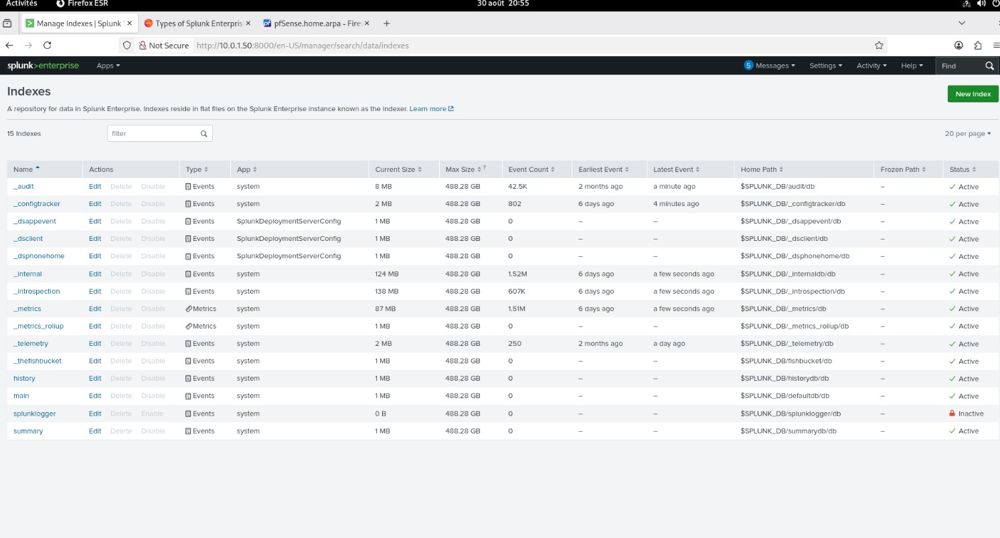
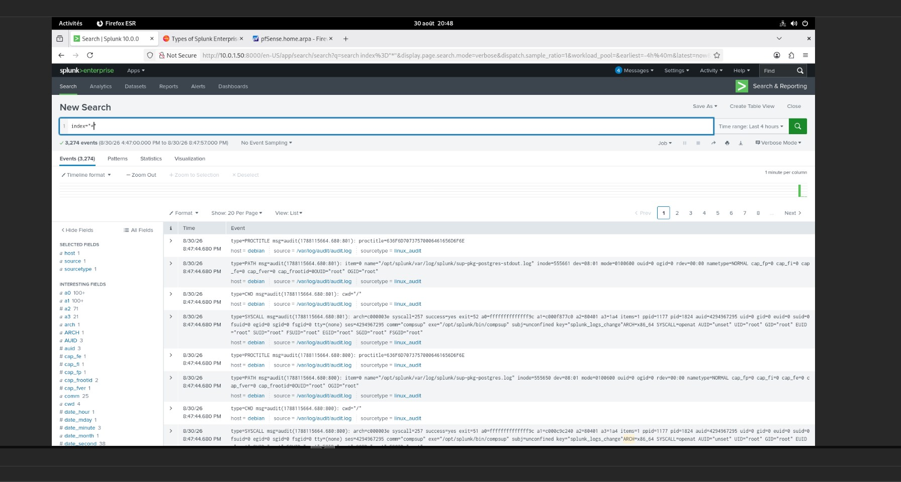

# Phase 3 — Analyse forensique et réponse à incident

[← Phase 2](02-tests-intrusion.md) · [README](../README.md) · [Phase 4 →](04-durcissement.md)

> **Objectif.** Interpréter les traces laissées par l'attaque, établir une chronologie fondée sur les preuves, identifier les indicateurs de compromission (IOC) et préparer le durcissement.
>
> Référence : mémoire, Phase 3 (p. 20-25) et Annexe C (p. 54).

**Cadrage.** Le fichier piégé a été déposé manuellement sur VM4 pour matérialiser un phishing réussi visant le PDG. La preuve technique porte sur une exécution sous le compte `IRON4SOFTWARE\test` ; l'association au PDG relève du rôle de VM4 dans le scénario, pas de l'identité Windows observée.

---

## 3.1 Le constat central : un SIEM installé mais aveugle

En se connectant à Splunk (VM5, `http://10.0.0.50:8000`) pour corréler les événements, l'équipe a obtenu **zéro résultat**.

| Élément | Valeur constatée | Attendu |
|---|---|---|
| Version | Splunk Enterprise 9.2.1 (édition gratuite) | service `splunkd` actif |
| Index `main` | **0 événement** | journaux généraux |
| Index `iron4software` | **0 événement** | journaux métier |
| Index `_internal` | 1,27 M événements | seul index actif (journaux de Splunk lui-même) |
| TCP Data Inputs | **0** | écoute sur 9997 |
| UDP Data Inputs | **0** | réception syslog |
| Forwarders — Windows Event Logs | **0** | VM3, VM4 |
| Forwarders — fichiers | **0** | journaux Apache (VM2) |
| HTTP Event Collector | désactivé | — |

Sur les seize index existants, seuls `_internal`, `_audit` et `_introspection` contenaient des données ; `main` et `iron4software` affichaient 1 Mo pour un compte d'événements nul.





*Annexe I.2 — vue des index et des événements : aucune machine du réseau ne remonte.*

### Ce que cette cécité a coûté

Sans journaux centralisés, il était impossible de :

- corréler dans une même chronologie la reconnaissance, l'accès au serveur web et le pivot ;
- recevoir une alerte lors du chiffrement massif ;
- rechercher par requête l'exécution de `powershell.exe` ou `mshta.exe` ;
- relier les connexions sortantes (C2) aux processus.

L'investigation a dû s'appuyer sur des **sources locales et manuelles** : journaux Apache lus directement sur VM2 (accessibles seulement par SSH faute de forwarder), Observateur d'événements ouvert à la main sur VM4, dump mémoire analysé sur VM5.

### Lacunes de télémétrie identifiées

| Lacune | Conséquence |
|---|---|
| **Sysmon absent** sur VM4 | aucun journal de création de processus ni de fichiers |
| **Audit avancé Windows désactivé** | pas de filiation des processus (WINWORD → mshta → powershell), pas de trace de suppression de fichier |
| **Aucun forwarder** | journaux Apache uniquement consultables sur l'hôte |
| **Journaux pfSense non centralisés**, pas de mirroring | aucune capture réseau complète du C2 |

Ces lacunes sont exactement celles que la [Phase 4](04-durcissement.md) traite.

---

## 3.2 Ce que Windows journalise par défaut : l'Event ID 4625

Deux échecs d'authentification ont été trouvés dans le journal *Security* de VM4 :

| Champ | Valeur |
|---|---|
| Compte | `kali` |
| Adresse source | `10.0.0.1` (VM2) |
| Station de travail | `KALI` |
| Type d'ouverture | 3 (réseau) |
| Horodatages | 26/08/2026 16:28:51 et 16:29:21 |

La station `KALI` associée à l'adresse source de VM2 indique une tentative **ayant transité par le pivot**, non une connexion directe. Les deux ouvertures ont échoué et ne démontrent aucune compromission de compte. C'est le seul signal d'intrusion que la journalisation native avait capturé.

---

## 3.3 Forensique mémoire (Volatility 3)

### Acquisition

Faute de journaux chronologiques, un dump mémoire de VM4 a été réalisé pour capturer l'état du système **avant toute modification**. VM4 n'ayant pas d'accès Internet, l'outil d'acquisition a été transféré depuis l'hôte Proxmox, puis le dump copié sur VM5 pour analyse (Annexe C.3) :

```powershell
PS> C:\Users\Test\Desktop\winpmem.exe C:\Users\Test\Desktop\vm4-memoire.raw
```

Sur Debian 12, l'installation de Volatility 3 par `pip3` est refusée (environnement Python géré par le système, PEP 668) ; elle a été faite via `pipx`.

### Résultats

| Plugin | Constat |
|---|---|
| `windows.info` | Windows 10 x64, `SystemTime` 2026-08-27 10:46:09 UTC — dump capturé **environ 16 h après le chiffrement** |
| `windows.pstree` | les processus Office et HTA attendus ne sont plus présents (terminés avant le dump) ; subsiste une chaîne PowerShell 32 bits : un processus parent (PID 8680) a lancé un enfant (PID **10852**) puis s'est terminé — technique d'évasion — l'enfant étant **toujours actif** |
| `windows.cmdline` | la ligne de commande du PID 10852 présente les marqueurs d'un chargeur en mémoire : exécution sans profil, fenêtre masquée, contenu compressé et encodé en Base64, exécution de bloc de script sans fichier. Ce processus n'est pas le script de chiffrement : c'est le **canal de commande** de l'attaquant |
| `windows.netscan` | connexion **ESTABLISHED** `10.0.0.3:61000 → 192.168.1.68:4444` détenue par le PID 10852, créée à 18:17:45 UTC (20:17:45 CEST), concordant à quelques secondes avec l'ouverture de session côté attaquant |
| chaînes Unicode du dump | présence répétée du chemin du fichier de clé |

**Conclusion forensique.** Un **canal C2 actif et persistant** est démontré sur VM4, sous `IRON4SOFTWARE\test`. Aucune preuve ne démontre une élévation au niveau SYSTEM ni un dump des secrets de l'Active Directory. La clé de chiffrement ayant été supprimée de VM4, **la restauration ne peut pas reposer sur elle** : en situation réelle, la reprise doit s'appuyer sur des sauvegardes, jamais sur la coopération de l'attaquant.

### Comptage des fichiers chiffrés

```powershell
PS> Get-ChildItem -Path C:\Users\Test -Recurse -Filter "*.ironlocked" | Measure-Object
Count : 30
```

Le script annonçait 29 fichiers ; l'investigation en recense 30. Les deux mesures portent sur des moments et des méthodes différents et sont conservées telles quelles.

---

## 3.4 Indicateurs de compromission

| Type | Valeur | Description |
|---|---|---|
| IP attaquante | `192.168.1.68` | source initiale WAN |
| Artefact scénarisé | `Avis_controle_URSSAF_2026.pdf.hta` | vecteur de phishing (fichier HTA à double extension), déposé manuellement |
| Script ransomware | `demo_ransom.ps1` | script PowerShell de chiffrement |
| Extension | `.ironlocked` | marqueur de chiffrement |
| Fichier de clé | `syskey.bin` | récupéré par l'attaquant puis supprimé de la cible |
| Processus | `powershell.exe` PID 10852 | PowerShell obfusqué maintenant le C2 |
| Connexion | `10.0.0.3:61000 → 192.168.1.68:4444` | canal C2 ESTABLISHED |
| Registre | `HKCU:\Control Panel\Desktop\Wallpaper` | fond d'écran modifié |
| Note de rançon | `LISEZ_MOI_AVANT.txt` (+ `ransom_wallpaper.bmp`) | déposée sur le Bureau |

---

## 3.5 Chronologie fondée sur les preuves (26-27 août 2026)

| Heure (CEST) | Événement | Preuve |
|---|---|---|
| 15:18-15:19 | Reconnaissance du serveur web | traces côté attaquant |
| 15:26 | Mise en place du pivot depuis le serveur web | traces côté attaquant |
| 15:33-16:08 | Énumération DNS / LDAP, contrôle MS17-010 non concluant | traces côté attaquant |
| 16:28-16:29 | Deux authentifications réseau échouées | Event 4625 ; station `KALI` ; source 10.0.0.1 ; type 3 |
| 19:59 | Création de l'artefact hameçon sur VM4 (simulation de phishing) | horodatage disque VM4 |
| 20:17 | Lancement de la chaîne PowerShell | Volatility : PID 8680 à 18:17:43 UTC, PID 10852 à 18:17:44 UTC |
| 20:17 | Établissement du canal C2 | Volatility : 18:17:45 UTC ; session attaquant à 20:17:51 +0200 |
| ≈ 21:03 | Impact ransomware, note et fond d'écran | sortie du script (29) ; investigation (30 `.ironlocked`) |
| après | Récupération puis suppression du fichier de clé | journal de session attaquant |
| 27/08 12:46 | Dump mémoire ; **C2 toujours actif** | `windows.info` 10:46:09 UTC ; `netscan` ESTABLISHED |

**Piège des fuseaux horaires.** Volatility exprime ses résultats en UTC, les consoles Kali et Windows en heure locale (CEST, UTC+2). La conversion suffit à aligner le C2 mémoire sur l'ouverture de session : il n'est pas nécessaire d'invoquer une désynchronisation NTP.

---

## 3.6 Mesures de réponse recommandées

### Confinement

- **Isoler VM4 sans l'éteindre** lorsque la préservation de la mémoire vive est prioritaire : une règle pfSense bloquant `10.0.0.3` en sortie coupe le C2 sans perdre l'état du système.

### Éradication (après acquisition des preuves)

- Arrêter le processus C2 (PID 10852).
- Supprimer les artefacts connus (`.hta`, fichiers `.tmp` suspects).
- Si l'intégrité du poste ne peut être garantie, **préférer une réinstallation ou une restauration depuis une source de confiance** à un simple nettoyage.
- Réinitialiser en priorité le compte techniquement compromis `IRON4SOFTWARE\test` ; dans le scénario où VM4 représente le poste du PDG, prévoir aussi la **rotation des identifiants du PDG** par précaution.

### Récupération

- Ne pas dépendre de la clé de l'attaquant : s'appuyer en priorité sur une **sauvegarde fiable et testée**.
- Dans le seul cadre pédagogique, la copie de clé conservée par la Red Team peut servir à valider le script de déchiffrement.
- En l'absence de sauvegarde exploitable et de clé autorisée, la récupération des fichiers chiffrés **ne peut être garantie**.

> **Enseignement.** L'absence de télémétrie centralisée et de sauvegardes testées alourdit fortement le coût d'investigation et de reprise. Ici, **l'analyse mémoire a été la seule source** capable de reconstituer le C2 et la filiation des processus — un luxe qu'on ne peut pas planifier. Ces mesures sont formalisées dans le [plan de réponse ISO 27035](07-reponse-incidents.md).

[← Phase 2](02-tests-intrusion.md) · [README](../README.md) · [Phase 4 →](04-durcissement.md)
