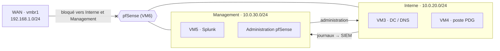
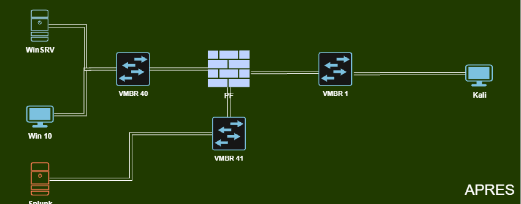
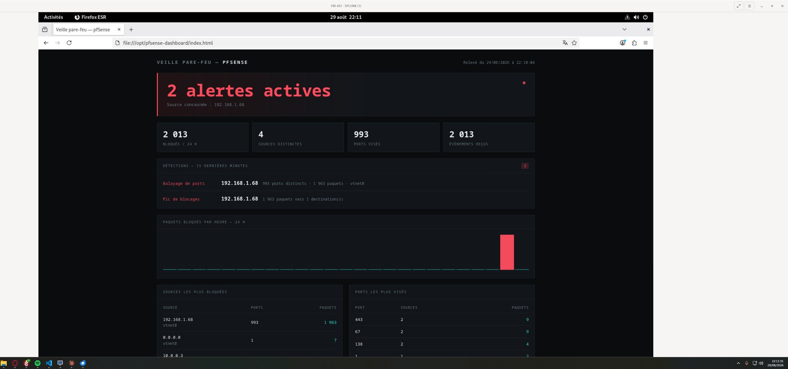

# Phase 4 — Durcissement de l'infrastructure

[← Phase 3](03-forensique.md) · [README](../README.md) · [Phase 5 →](05-re-attaque.md)

> **Objectif.** Appliquer et documenter les mesures réellement exécutées sur VM3, VM4 et VM5, puis définir les mesures d'architecture nécessaires pour empêcher la reproduction de la chaîne d'attaque.
>
> Référence : mémoire, Phase 4 (p. 26-34) et Annexe D (p. 55-56).

**Règle de lecture.** Les journaux d'exécution montrent des corrections effectives, mais aussi des avertissements et des commandes en erreur. Ces limites sont conservées : chaque mesure est évaluée sur **les sorties réellement observées**, pas sur le message final `[OK]` d'un script.

---

## Sommaire

1. [Périmètre réellement exécuté](#41-périmètre-réellement-exécuté)
2. [Le SIEM comme cas d'école](#42-le-siem-comme-cas-décole)
3. [Segmentation réseau et traitement de VM2](#43-segmentation-réseau-et-traitement-de-vm2)
4. [Durcissement des systèmes Windows](#44-durcissement-des-systèmes-windows)
5. [Supervision : SIEM, IDS et alerting](#45-supervision--siem-ids-et-alerting)
6. [VPN itinérant WireGuard (cible)](#46-vpn-itinérant-wireguard-cible)
7. [Sauvegarde et continuité 3-2-1 (cible)](#47-sauvegarde-et-continuité--cible-3-2-1)
8. [Ce que la phase a appris](#48-ce-que-la-phase-a-appris)

---

## 4.1 Périmètre réellement exécuté

| Composant | Action observée | Statut / réserve |
|---|---|---|
| VM2 | Déconnexion du laboratoire | **Réalisé** ; script de durcissement `harden-vm2.sh` non exécuté |
| VM3 | Durcissement Windows Server | **Réalisé avec réserves** : redémarrage requis pour SMBv1, erreurs AuditPol, règle RDP personnalisée créée |
| VM4 | Durcissement Windows 10 | **Réalisé avec réserves** : erreurs liées au mode de langage contraint et à AuditPol, contrôles finaux principaux positifs |
| VM5 | Durcissement Debian / Splunk | **Réalisé avec réserves** : erreur ICMP UFW, règle LAN large ajoutée ; forwarders distants non démontrés |
| Chaîne pfSense → Splunk, Snort, alerting | Collecte, IDS et détection automatique | **Réalisé et démontré** |
| Segmentation | `network-segmentation.sh` | **Non exécuté** — architecture cible |
| WireGuard | Configuration proposée | **Non démontré** dans les journaux |
| Sauvegarde 3-2-1 | Politique de continuité | **Cible** ; restauration Veeam non démontrée |

---

## 4.2 Le SIEM comme cas d'école

La Phase 3 a fait de Splunk l'exemple type du **SIEM « décoratif »** : installé, présent dans l'architecture, cité dans la documentation, mais inopérant au moment de l'incident.

| Indicateur | Au moment de l'attaque | Attendu |
|---|---|---|
| Index `main` | 0 événement | > 100 000 / jour |
| Index `iron4software` | 0 événement | > 50 000 / jour |
| Forwarders déployés | 0 sur 4 machines | 4 / 4 |
| TCP Data Inputs (9997) | 0 | 1 (écoute forwarders) |
| Syslog UDP | 0 | 1 (réception pfSense) |
| Windows Event Logs transférés | 0 | VM3 + VM4 |
| Journaux Apache transférés | 0 | VM2 |

Le SIEM n'avait vu ni la reconnaissance, ni le webshell, ni le callback C2. **Un SIEM ne vaut que si ses sources sont réellement raccordées, horodatées et testées.** Le durcissement de VM5 prépare l'index, les services locaux, le pare-feu et les protections ; le déploiement complet des forwarders distants n'est en revanche pas démontré par les journaux, et n'est donc pas compté comme acquis.

---

## 4.3 Segmentation réseau et traitement de VM2

### Architecture cible

Objectif : empêcher qu'une compromission de poste ne donne accès à tout le réseau interne, en séparant les ressources internes des équipements d'administration et de supervision. La séparation repose sur des **ponts virtuels Proxmox** (`vmbr`) routés et filtrés par pfSense — d'où le terme « segment » plutôt que « VLAN ».

| Segment | Réseau | Machines | Fonction |
|---|---|---|---|
| **Interne** | 10.0.20.0/24 | VM3 (DC), VM4 (poste PDG) | ressources internes, jamais exposées directement |
| **Management** | 10.0.30.0/24 | VM5 (Splunk), VM6 (administration pfSense) | supervision et administration uniquement |

### Matrice de flux pfSense

| Source | Destination | Action | Justification |
|---|---|---|---|
| Interne | Management | **Autoriser** | les postes et le DC envoient leurs journaux au SIEM |
| Management | Interne | **Autoriser** | l'administrateur peut gérer les postes et le DC |
| WAN | Interne & Management | **Bloquer** | aucune redirection depuis le WAN vers les réseaux internes |





*Schéma « après » (Annexe I.4) : le SIEM est sorti du LAN des postes et placé sur un pont dédié ; Kali reste seul côté WAN.*

> **Statut.** Le script `network-segmentation.sh` n'a **pas été exécuté** dans la version de preuve du mémoire (Annexe D.5) : la segmentation est présentée comme **architecture cible et prototype**, pas comme un déploiement démontré par les journaux.

### Traitement du risque lié à VM2

VM2 a été le premier point d'appui de l'attaque : sa compromission ouvrait le réseau interne. Analyse inspirée d'ISO/IEC 27005:2022 :

| Élément | Évaluation |
|---|---|
| Actif | site vitrine et infrastructure d'hébergement |
| Menace | compromission du serveur web exposé |
| Vulnérabilités | hébergement local, Apache/Docker, maintenance manuelle |
| Conséquence | serveur utilisé comme point de pivot vers le LAN |
| Niveau de risque | **Élevé** |

**Option retenue pour la cible : externaliser le site vitrine** vers une plateforme managée (type Vercel) — un transfert et une réduction du risque.

| Critère | VM2 auto-hébergé (même durci) | Hébergement managé (Vercel) |
|---|---|---|
| Surface réseau | ports 80/443 redirigés depuis le WAN | aucun port exposé dans le LAN |
| Gestion des CVE | manuelle (équipe à mi-temps) | assurée par le fournisseur |
| Segmentation | nécessite une DMZ + règles pfSense | hors périmètre LAN |
| Coût | maintenance VM + supervision | gratuit à faible coût |
| Pivot vers le LAN | possible si compromission | impossible (pas d'OS, pas de LAN) |

**En pratique :**

- VM2 a été **déconnectée** du laboratoire, sans durcissement appliqué ;
- l'externalisation est une **cible d'architecture**, non un déploiement prouvé ;
- la bascule DNS reste à réaliser et à valider ;
- les redirections NAT HTTP/HTTPS doivent être retirées ;
- la page « Équipe » peut rester publique pour le réalisme, mais doit être découplée du LAN ;
- le risque n'est pas entièrement levé : sécurité des comptes GitHub/Vercel, DNS et chaîne de déploiement restent à la charge de l'entreprise.

Le script `harden-vm2.sh` (durcissement Apache/Docker, réduction des privilèges, filtrage local) reste un élément documentaire : la machine ayant quitté le chemin opérationnel, il ne compte pas dans les résultats.

> **Pour une TPE sans ressources dédiées, la meilleure défense contre la compromission d'un serveur web est souvent de ne pas en héberger localement.**

---

## 4.4 Durcissement des systèmes Windows

### VM3 — Windows Server 2019 (contrôleur de domaine)

Le script commence par une erreur de syntaxe sur la directive `#Requires -RunAsAdministrator` puis se poursuit ; les résultats sont évalués sur les sorties observées.

| Vulnérabilité | Correction appliquée | Réserve |
|---|---|---|
| SMBv1 activé | Désactivation demandée, **signature SMB requise** | `RestartNeeded: True` — redémarrage requis pour finaliser |
| Defender désactivé | Protection temps réel, comportementale et IPS réactivées | vérification finale positive |
| Pare-feu désactivé | Pare-feu activé, **blocage entrant par défaut** | vérification finale positive |
| Windows Update arrêté | Service réactivé | — |
| RDP | NLA, couche TLS et chiffrement fort ; règle `RDP-LAN-Only` restreignant RDP au LAN (10.0.0.0/24) | une commande visant la règle native `RemoteDesktop-UserMode-In-TCP` échoue (nom inexistant) ; la règle personnalisée est bien créée |
| Mots de passe faibles | Politique à **12 caractères**, complexité, **verrouillage après 5 échecs** ; mot de passe Administrateur renouvelé | — |
| Transfert de zone DNS ouvert | AXFR **restreint aux serveurs de noms autorisés** | — |
| Audit avancé absent | Activation de l'audit des événements 4688 (création de processus), 4663 (accès aux objets), 4625 (échec d'authentification) | plusieurs `auditpol` retournent `0x00000057` : **appliqué avec réserve**, à valider par `auditpol /get` |
| Pas de Sysmon | **Sysmon 15.21** installé, configuration validée, service démarré | — |

Extrait du journal d'exécution (Annexe D.2) :

```text
[OK] Windows Defender activé (Temps réel, Comportement, IPS)
[OK] Pare-feu Windows activé (Block inbound par défaut)
[OK] Windows Update réactivé
=== Désactivation SMBv1 ===   RestartNeeded : True   [OK] SMBv1 désactivé
[OK] Signature SMB requise
=== RDP === [OK] NLA activé, couche TLS, chiffrement fort
DisplayName : RDP-LAN-Only   Enabled : True
Set-NetFirewallRule ... RemoteDesktop-UserMode-In-TCP : objet introuvable
[OK] RDP restreint au LAN (10.0.0.0/24)
```

### VM4 — Windows 10 (poste du PDG)

Les mesures ciblent précisément la chaîne observée : fichier HTA, PowerShell en mémoire, chiffrement du profil.

| Vulnérabilité | Correction appliquée | Réserve |
|---|---|---|
| Protection anti-ransomware | Defender renforcé et **Controlled Folder Access** activé | — |
| Pare-feu | Activé, blocage entrant par défaut | — |
| RDP | NLA + TLS | — |
| Macros Office | **Blocage du contenu Office venant d'Internet**, niveau de sécurité macros élevé | — |
| HTA (vecteur du scénario) | **Exécution HTA bloquée** par politique locale | `mshta.exe` reste présent sur le système |
| PowerShell non journalisé | **ScriptBlockLogging** et **Transcription** activés | — |
| PowerShell v2 (contournement de journalisation) | Composant désactivé (`RestartNeeded: False`) | — |
| PowerShell — langage | **Constrained Language Mode** | la tentative de définir `__PSLockDownPolicy` retourne `MethodInvocationNotSupportedInConstrainedLanguage`, cohérent avec une session déjà contrainte : conservé avec réserve |
| SMB | **Signature SMB requise**, compte Invité désactivé, durcissement des partages administratifs | — |
| AutoRun USB | Désactivé pour tous les types de lecteurs | — |
| Audit avancé | Activé par GUID | premières commandes `auditpol` en erreur `0x00000057` |
| Supervision Sysmon | Configuration validée | service déjà enregistré (installation préalable, pas un échec) |

Extrait du journal d'exécution (Annexe D.3) :

```text
(OK) Defender + Controlled Folder Access
(OK) Pare-feu active (Block inbound)
(OK) RDP NLA + TLS
Restriction PowerShell : MethodInvocationNotSupportedInConstrainedLanguage
(OK) PowerShell Constrained Language Mode active
(OK) PowerShell v2 desactive
(OK) Logging PowerShell active (ScriptBlock + Transcription)
(OK) Macros Office : blocage Internet + niveau securite eleve
(OK) Execution HTA bloquee
(OK) Signature SMB requise + Guest desactive
(OK) AutoRun USB desactive
```

---

## 4.5 Supervision : SIEM, IDS et alerting

Le dispositif repose sur **trois niveaux de défense**, entièrement bâtis sur des composants libres ou en édition gratuite :

1. **pfSense `filterlog`** — ce que le pare-feu bloque ;
2. **Snort** — ce que le trafic autorisé contient de malveillant ;
3. **Splunk + alerting maison** — corrélation, seuils, alerte et restitution.

Bénéfices pour une TPE : coût de licence nul, visibilité réseau dès le point d'entrée, détection comportementale là où le seul journal de pare-feu se limiterait à constater un blocage.

### État cible et état atteint

| Élément | Avant (Phase 3) | État atteint |
|---|---|---|
| Instance Splunk (VM5) | non durcie | Splunk Enterprise 9.2.1 opérationnel et durci |
| Index `pfsense` | inexistant | **opérationnel — 2 034 événements sur 24 h**, ingestion continue |
| Port 5514/UDP | fermé | ouvert et validé — flux syslog pfSense reçu en continu |
| Port 9997 (forwarders) | fermé | écoute activée, plateforme prête pour extension |
| Snort sur pfSense | non installé | déployé en édition gratuite — règles Community et Emerging Threats |
| Extraction de champs | aucune | parsing `filterlog` : **plus de 20 champs typés** |
| Alerting | absent | dispositif autonome — **analyse toutes les 5 minutes** |
| Restitution | aucune | tableau de bord de veille local |
| Durcissement VM5 | aucun | SSH sur 2222, UFW, Fail2Ban, auditd |

### Collecte des journaux pfSense

La chaîne de collecte du pare-feu est **démontrée de bout en bout**.

**Côté pfSense** — *Status → System Logs → Settings* :

| Paramètre | Valeur |
|---|---|
| Journalisation distante | activée |
| Serveur distant | `10.0.0.50:5514` (VM5) |
| Catégories transmises | *Firewall Events* et *Snort / IDS* |

**Côté Splunk** — entrée de données :

| Paramètre | Valeur |
|---|---|
| Type | UDP |
| Port | `5514` |
| Index | `pfsense` |
| Sourcetype | `pfsense` |

> **Choix de conception.** Un port non privilégié (5514 plutôt que 514) évite d'exécuter le collecteur avec des privilèges élevés.

**Résultat** — la recherche suivante, sur 24 h, retourne **2 034 événements** :

```spl
index=pfsense filterlog
```

avec extraction native des champs du format `filterlog` :

| Champ | Cardinalité | Valeur opérationnelle |
|---|---|---|
| `action` | 1 (block) | filtrage des paquets rejetés |
| `src_ip` / `dest_ip` | 4 | source et cible |
| `dest_port` | > 100 | socle de la détection de balayage |
| `direction` | 1 (in) | sens du flux |
| `interface` | 3 | point d'entrée (`vtnet0`, `vtnet1`) |
| `ip_version` | 2 | couverture IPv4 et IPv6 |
| `rule` | 6 | règle pare-feu déclenchante |
| `reason` | 2 | motif du blocage |
| `proto` | TCP / UDP / ICMP / IGMP | discrimination protocolaire |

Les recherches de détection s'appuient sur des **champs structurés** et non sur de l'analyse de chaînes : meilleure fiabilité, meilleures performances à volume croissant.

### Snort en complément du filtrage

`filterlog` répond à « ce paquet a-t-il été bloqué ? ». **Snort** répond à « ce trafic autorisé est-il malveillant ? ». Il couvre :

- les tentatives d'exploitation applicative dans des flux légitimes (HTTP/HTTPS) ;
- les signatures de reconnaissance (scanners de ports et de vulnérabilités web) ;
- les communications C2 vers des infrastructures connues ;
- les tentatives de force brute.

| Paramètre | Choix |
|---|---|
| Emplacement | package pfSense, **interface WAN** |
| Édition / règles | gratuite — **Community** et **Emerging Threats** |
| Mode | **détection** (IDS), pas blocage |
| Remontée | vers Splunk par le canal syslog existant (5514/UDP) |

Le mode détection écarte tout risque de coupure sur faux positif tout en conservant la valeur d'analyse. Le passage en prévention (IPS) est envisagé après une période d'observation permettant d'affiner les règles.

### Durcissement de la machine de supervision (VM5)

Le script `harden-vm5.sh` a été exécuté. Mesures confirmées :

| Domaine | Mesure |
|---|---|
| Système | mise à jour complète, outils installés |
| SSH | écoute sur **2222**, **connexion root interdite**, **authentification par clé uniquement**, `MaxAuthTries 3` |
| Splunk | redémarrage ; écoute sur **9997** (forwarders), **8000** (web), **8089** (API de gestion) |
| Index et entrées locales | index `iron4software` créé ; entrées locales `syslog`, `auth.log`, `audit.log` |
| Syslog | ouverture contrôlée du canal UDP 5514, réception validée |
| Pare-feu hôte | **UFW** en `deny incoming` avec règles explicites pour 2222, 8000, 8089, 9997 et 5514 |
| Anti-bruteforce | **Fail2Ban** avec jails SSH et Splunk Web |
| Audit système | **auditd** activé |
| Forwarders | guide de déploiement affiché, à exécuter sur VM3, VM4 et VM6 (**non démontré**) |

Extrait du journal d'exécution (Annexe D.4) :

```text
[OK] Système mis à jour et outils installés
[OK] SSH durci (no root, clés uniquement, MaxAuthTries 3)
[OK] Splunk redémarré ; écoute sur 9997, 8000, 8089
[OK] Index iron4software configuré + inputs locaux (syslog, auth, audit)
[OK] Guide de déploiement forwarders affiché (à exécuter sur VM3/VM4/VM6)
```

**Ajustement documenté.** La règle ICMP échoue (`Unsupported protocol 'icmp'`), UFW ne prenant pas en charge cette syntaxe :

```text
ufw allow proto icmp from 10.0.0.0/24
```

UFW reste activé en `Default: deny (incoming)` ; une règle plus large a été ajoutée pour rétablir la connectivité de supervision, qui apparaît ensuite comme `Anywhere ALLOW IN 10.0.0.0/24` :

```text
ufw allow from 10.0.0.0/24
```

Elle autorise **tout le LAN** et pas seulement l'ICMP : en production, elle doit être resserrée vers les seules adresses d'administration. La consigner fait partie de la démarche d'amélioration continue.

### Alerting : une réponse à la contrainte de licence

**Le problème.** Les alertes programmées de Splunk relèvent de la licence commerciale ; l'édition gratuite limite l'usage à la recherche interactive. Une supervision continue par le produit seul était donc impossible.

**La solution.** Plutôt que renoncer ou engager une dépense, un **dispositif autonome** a été développé autour de l'interface en ligne de commande de Splunk, accessible sans restriction :

```text
cron (*/5 min)
  └─> splunk search "index=pfsense ..." -output csv   (exécution CLI locale, hors périmètre licencié)
      └─> post-traitement : agrégation, corrélation multi-sources, application des seuils
          └─> sérialisation JSON → tableau de bord de veille
               → détection · alerte · restitution
```

| Fonction | Mise en œuvre |
|---|---|
| Surveillance continue | exécution automatisée toutes les 5 minutes |
| Détection sur seuils | règles de corrélation appliquées aux résultats SPL |
| Notification | bandeau d'alerte avec compteur et source concernée |
| Restitution | agrégation métier lisible plutôt qu'une liste brute |
| Analyse de tendance | histogramme des blocages par heure sur 24 h |
| Priorisation | classements des sources et des ports les plus sollicités |
| Coût de licence | **nul** |

Le dispositif transforme un outil de recherche *a posteriori* en **poste de supervision proactif** : détection sans intervention humaine, restitution exploitable par un opérateur non spécialiste du SPL, suivi des tendances dans la durée.

### Preuves de fonctionnement

| Indicateur | Valeur |
|---|---|
| Alertes actives | **2** |
| Paquets bloqués sur 24 h | **2 013** |
| Sources distinctes | **4** |
| Ports visés | **993** |



*Annexe I.3 — détection du balayage de ports remontée par le dispositif d'alerting.*

Deux détections remontées **automatiquement** sur une fenêtre de quinze minutes :

1. **Balayage de ports** depuis `192.168.1.68` — 993 ports distincts, 1 963 paquets, interface `vtnet0` ;
2. **Pic de blocages** associé — 1 963 paquets vers une destination unique.

**Lecture.** 993 ports pour 1 963 paquets vers une seule cible sur un intervalle court est caractéristique d'un balayage SYN sur les mille ports les plus courants ; le ratio de deux paquets par port correspond au comportement de retransmission de ce type de scan. L'histogramme confirme le caractère ponctuel : activité nulle sur vingt-trois heures, pic unique sur la dernière tranche.

La détection est **confirmée par les deux couches** : `filterlog` par l'analyse volumétrique, Snort par signature. Une couche seule produit un signal ; deux couches concordantes en font une certitude — l'intérêt concret de la défense en profondeur.

---

## 4.6 VPN itinérant WireGuard (cible)

WireGuard est retenu pour les accès distants. Il **supprime l'exposition directe des services** — en particulier le RDP, très exposé aux attaques externes — et repose sur des **paires de clés asymétriques**, pour un accès fermé et performant.

| Direction | Source | Destination | Action |
|---|---|---|---|
| WAN → pfSense | Any | `51820/UDP` | **Autoriser** |
| Tunnel → Interne | 10.200.0.0/24 | 10.0.20.0/24 | **Autoriser** |
| Tunnel → WAN | 10.200.0.0/24 | Any | **Bloquer** |
| Tunnel → Management | 10.200.0.0/24 | 10.0.30.0/24 | **Bloquer** |

Principes de la matrice : un seul port exposé ; les utilisateurs nomades atteignent les ressources internes mais **jamais le segment d'administration** ; le tunnel ne sert pas de sortie Internet. La PSSI y associe la **MFA** sur l'accès VPN.

> **Statut.** Déploiement présenté comme **cible** : les journaux ne le démontrent pas en exploitation.

---

## 4.7 Sauvegarde et continuité — cible 3-2-1

L'incident l'a montré : la clé ayant disparu de la cible, **seules des sauvegardes indépendantes de la production** permettent la reprise. Le dispositif ci-dessous est la politique cible ; rétention, outil Veeam, stockage distant et tests de restauration sont définis mais **pas revendiqués comme éprouvés**.

| Couche | Fréquence | Support | Localisation |
|---|---|---|---|
| 1 — Production | continue | stockage des VM | infrastructure Proxmox |
| 2 — Sauvegarde locale | quotidienne (cible) | HDD | local |
| 3 — Copie hors ligne | périodique | support hors ligne | emplacement sécurisé séparé |
| 4 — Copie distante | selon RPO | stockage distant chiffré | Infomaniak |
| 5 — Journaux SIEM | quotidienne (cible) | archive des configurations et index | VM5 + stockage distinct |

**Choix de l'hébergeur distant.** Dans une démarche alignée sur ISO 27005, l'externalisation chez **Infomaniak** (hébergeur suisse) permet de s'affranchir des grands fournisseurs cloud américains et des lois extraterritoriales telles que le CLOUD Act, et de garder la maîtrise du lieu de stockage.

**Code et documents critiques.** Le versionnage hors poste (dépôts GitHub privés, MFA, branches protégées) est retenu comme mesure de résilience ; il réduit l'impact d'un chiffrement local mais doit être complété par des sauvegardes indépendantes du fournisseur.

**Cibles par machine :**

| Machine | Cible de sauvegarde |
|---|---|
| VM3 (DC) | sauvegarde quotidienne complète vers un support déconnectable ; rétention et tests documentés |
| VM4 (poste PDG) | données utilisateur et éléments de reconstruction ; rotation de supports hors ligne |
| VM5 (Splunk) | index et configurations vers un stockage distinct, copie distante, vérification de la capacité de rejeu |
| Stockage distant | contrôle d'intégrité, accès restreint au segment Management, supervision des erreurs |

**Validation.** Un exercice de restauration doit être organisé périodiquement et **chronométré** pour valider les RTO/RPO (voir [Phase 6](06-risques-conformite.md#64-plan-de-sauvegarde-3-2-1)). Faute de journal de test, aucun temps de restauration mesuré n'est revendiqué.

---

## 4.8 Ce que la phase a appris

- **Retirer vaut souvent mieux que durcir** : déconnecter VM2 interrompt le point de pivot pour un effort minimal.
- **Vérifier la réception, pas le service** : la chaîne pfSense → Splunk est jugée opérationnelle parce que l'index compte 2 034 événements, pas parce que le port écoute.
- **Contourner une contrainte de licence par l'ingénierie** : quelques briques (cron, CLI Splunk, post-traitement, page HTML) suffisent à obtenir une détection continue à coût nul.
- **Défense en profondeur mesurable** : deux couches indépendantes concordantes sur la même détection.
- **Documenter les erreurs** (`0x00000057`, règle UFW trop large, redémarrage SMBv1 en attente) plutôt que se fier aux messages `[OK]`.
- **Ce qui reste à faire** : forwarders VM3/VM4/VM6, centralisation Windows et Sysmon, segmentation, WireGuard, 3-2-1 testée.

[← Phase 3](03-forensique.md) · [README](../README.md) · [Phase 5 →](05-re-attaque.md)
